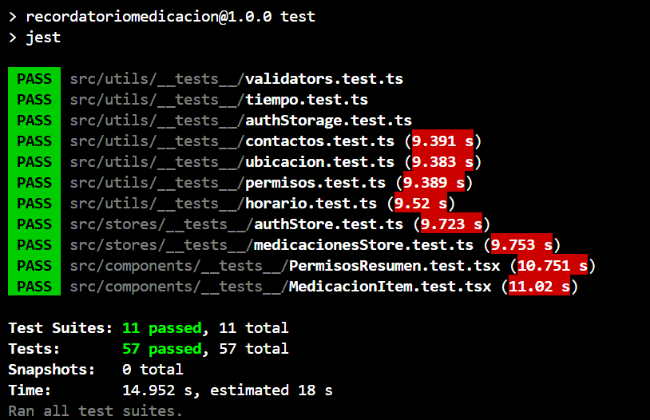

# 💊 Recordatorio de Medicación

Aplicaciones Móviles — (React Native + Expo SDK 57)

## Opción elegida

**Recordatorio de medicación**: el usuario registra sus medicamentos con nombre, hora y foto, recibe una notificación local para la toma y puede asociar a cada medicación la farmacia donde la compra, un médico o familiar de su agenda y un evento diario en el calendario del celular.

## 🎥 Videos demo

- **Parcial 2**: [Ver en YouTube](https://www.youtube.com/shorts/ggmmX0HhbcA)
- Parcial 1: [Ver en YouTube](https://www.youtube.com/shorts/yBNPnYDb3AQ)

## Cómo ejecutar la app

```bash
npm install
npx expo start
```

Escanear el QR con **Expo Go para SDK 57** (Android/iOS) o presionar `a` para abrir un emulador Android.

## Cómo correr los tests

```bash
npm test
```

Los tests con **Jest + React Native Testing Library** se hicieron en el Parcial 1 y se actualizaron para acompañar los cambios (11 archivos, 57 tests): stores de Zustand, validaciones, lógica de horario, ubicación, contactos y permisos, y los componentes `MedicacionItem` y `PermisosResumen`.



## Nuevas funcionalidades
###  Permisos y acceso a recursos del dispositivo
- Hook propio **`usePermisos`** que centraliza los permisos de cámara, galería, ubicación, contactos y calendario: **verifica** el estado, **pide** el permiso solo si hace falta y **maneja el rechazo**.
- Maneja los tres estados: **concedido, denegado y pendiente**. En la pantalla de detalle se ven en el componente reutilizable **`PermisosResumen`**.
- Si se rechaza un permiso, se muestra un **mensaje claro** explicando qué no se puede hacer, y si quedó bloqueado ofrece **Abrir ajustes**. Los estados se actualizan al volver de Ajustes.
- Cada recurso tiene un **fallback**: galería si no hay cámara (y al revés), dirección escrita a mano si no hay ubicación, contacto cargado a mano si no hay acceso a la agenda.

###  Cámara y galería (`expo-camera` + `expo-image-picker`)
- En el alta: **📷 Sacar foto** (pantalla de cámara con cambio trasera/frontal) o **🖼️ Galería** (con recorte cuadrado).
- La foto se copia a la carpeta de la app con `expo-file-system` para que no se pierda, se muestra como miniatura en la **lista** y en grande en el **detalle**, y se borra al eliminar la medicación.

###  Ubicación de la farmacia (`expo-location`)
- **Usar mi ubicación actual**: obtiene las coordenadas con GPS y una **dirección aproximada** con `reverseGeocodeAsync`.
- Se muestran la dirección, las coordenadas y un link **🗺️ Ver en el mapa** (Google Maps). También aparece en la lista.

###  Contactos y calendario
- **Contacto (`expo-contacts`)**: lista de la agenda con **buscador por nombre** para elegir al médico o familiar. Se muestra con su teléfono y un botón **📞 Llamar**.
- **Calendario (`expo-calendar`)**: crea un **evento diario** a la hora de la toma, con aviso 5 minutos antes, en el calendario del celular. Se puede quitar, y se borra solo al eliminar la medicación.

###  Estado global con Zustand
- **`authStore`**: usuario logueado, `login()` y `logout()`. Reemplazó al `AuthContext`; con el middleware `persist` la sesión se guarda sola en AsyncStorage.
- **`medicacionesStore`**: medicaciones de cada usuario con las acciones **`agregar`, `eliminar` y `actualizar`**. `actualizar` se usa para asociar farmacia, contacto y evento de calendario.
- Las pantallas leen y modifican el estado con **selectores** (`useMedicacionesStore(selectMedicacionesDe(usuario))`), así solo se redibujan cuando cambia lo que usan. Ya no hace falta `useFocusEffect` para recargar la lista.
- Se eligió **Zustand** porque la app es chica (dos estados globales) y necesita mucho menos código que Redux Toolkit: no requiere Provider, slices ni dispatch.

## Funcionalidades del Parcial 1

- Registro y login local (el usuario debe ser un email **@gmail.com**, contraseña de 6 caracteres o más).
- Sin sesión solo se puede acceder a Login y Registro (navegación condicional según el store).
- Alta, lista y eliminación de medicaciones, con datos que se mantienen al cerrar la app.
- Notificación local configurable en segundos, minutos u horas.
- Componente reutilizable `MedicacionItem`.

## Estructura

```
src/
├── components/   MedicacionItem, PermisosResumen + tests
├── hooks/        usePermisos (lógica centralizada de permisos)
├── navigation/   AppNavigator (Stack Navigation) + tipos
├── screens/      Login, Registro, Home, AltaMedicacion, Camara, DetalleMedicacion, Contactos
├── stores/       Estado global con Zustand: authStore, medicacionesStore + tests
└── utils/        Usuarios, notificaciones, fotos, calendario, ubicación, contactos,
                  horario, permisos, validaciones + tests
```